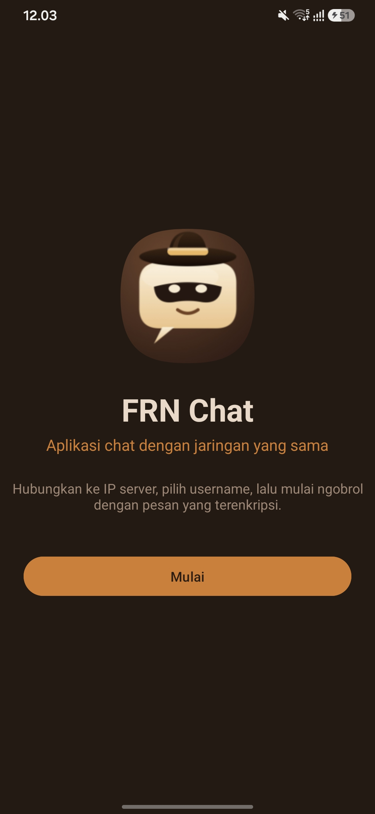
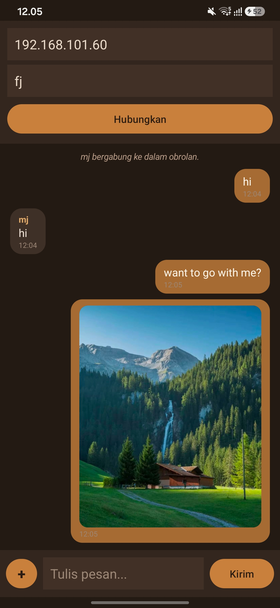

# FRN Chat (Android)

A local chat app for Android, written in Kotlin. Chat with friends on the same Wi-Fi network, with no internet and no account. Text, photos, and videos are sent over TCP sockets and encrypted with AES-256-GCM.

Works together with the desktop client and server in [FRN-Chat](https://github.com/FajarRahmadani/FRN-Chat).

## Screenshots

|               Screen 1: Welcome                |                 Screen 2: Chat                 |
|:----------------------------------------------:|:----------------------------------------------:|
|  |  |

## Features

- Welcome screen with a zoom transition into the chat screen
- Group chat with message bubbles
- Send and open photos and videos (photos up to 1600 px, videos up to 10 MB)
- AES-256-GCM encryption on every message
- Works in the same chat room as the desktop client and other Android phones

## Download

Download `FRNChat-v1.0.apk` from [Releases](https://github.com/FajarRahmadani/FRNChatKotlin/releases/latest) and install it. Android will ask you to allow installing from an unknown source; this is normal for apps outside the Play Store.

## How to Use

1. **Start a server** on one device:
    - On a computer: download and run `FRN Chat Server.exe` from [FRN-Chat Releases](https://github.com/FajarRahmadani/FRN-Chat/releases/latest).
    - Or on a phone: use [FRNChatServer](https://github.com/FajarRahmadani/FRNChatServer).
2. Connect the phone to the **same Wi-Fi** as the server.
3. Open FRN Chat, tap **Start**, enter the **server IP address** and a **username**, then tap **Connect (Hubungkan)**.

To find the server's IP on Windows, run `ipconfig` and look for **IPv4 Address**.

## Passphrase

All clients must use the same passphrase, otherwise messages cannot be decrypted. The Android app has it set in `EMBEDDED_SECRET` in `MainActivity.kt`. The desktop client must use the same passphrase. Since it is public in this repository, change it before any serious use and rebuild all clients.

## Run from Source

```bash
git clone https://github.com/FajarRahmadani/FRNChatKotlin.git
```

1. Open the folder in Android Studio and wait for the Gradle sync to finish.
2. Connect a phone (USB debugging on) or start an emulator.
3. Click **Run**.

Requires Android 8.0 (API 26) or newer.

## Project Structure

```
app/src/main/
  java/com/example/frnchatkotlin/
    WelcomeActivity.kt   # screen 1
    MainActivity.kt      # screen 2: chat, media, encryption
  res/layout/            # activity_welcome.xml, activity_main.xml
  res/anim/              # zoom transition animations
```

## UI Components

`LinearLayout`, `ScrollView`, `TextView`, `EditText`, `Button`, `ImageView`, and `VideoView` (in a `Dialog`). Layouts are written in XML; colors and strings are in `res/values/`.

## Course Assignment

**Assignment 1: Designing a Basic Mobile App Interface (Meeting 5)**
**Name:** Fajar Rahmadani | **Student ID:** 24091013 | **Universitas Bhamada Slawi**

- **Idea:** a simple local chat app that works without internet.
- **Screens:** Welcome screen and Chat screen (see Screenshots above).
- **How to run:** see Run from Source above.

## Security

This project is for learning and trusted local networks. There is no authentication, TLS, or identity verification, and the default passphrase is public. Do not use it for sensitive data.

## License

[MIT](LICENSE)